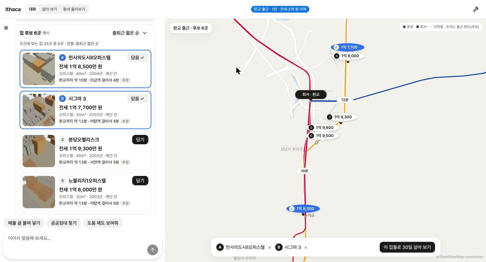
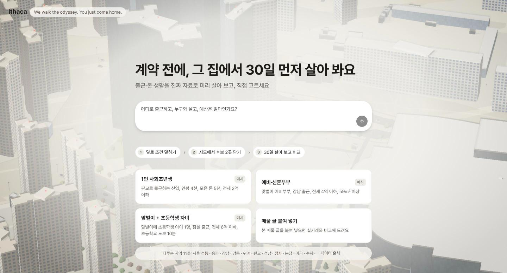
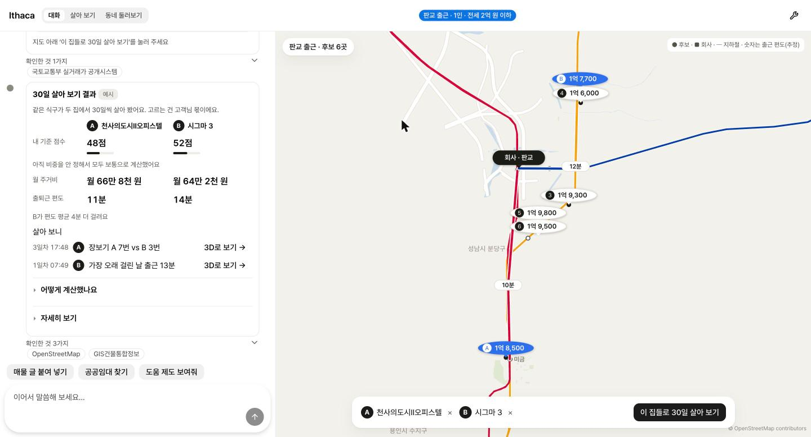
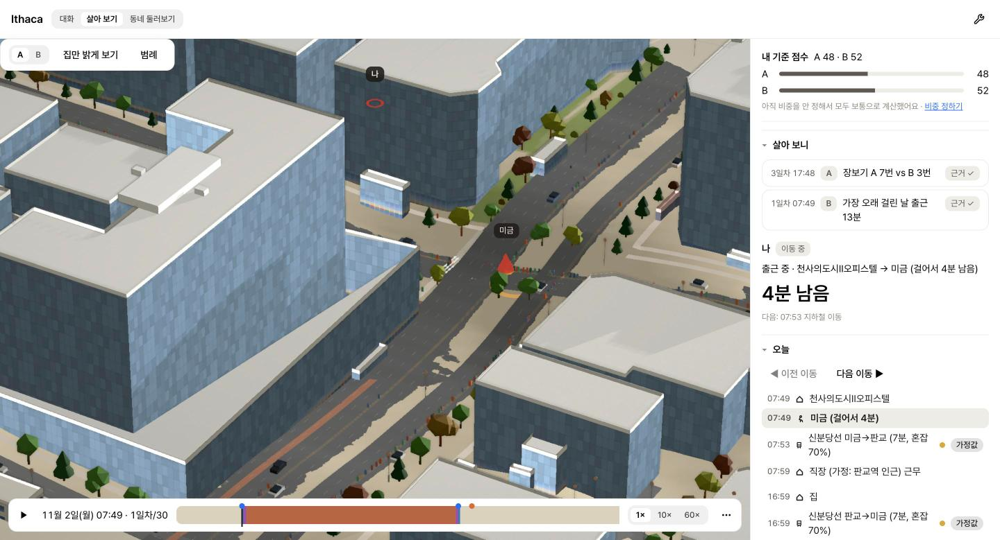
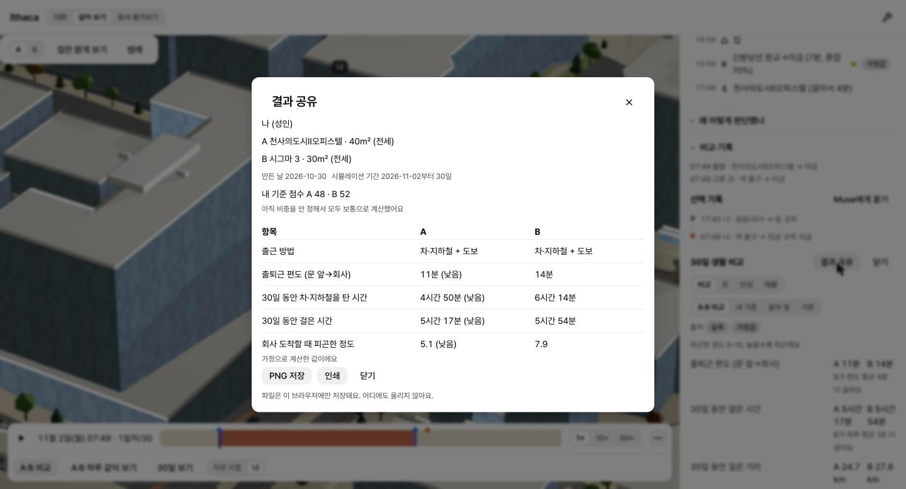

<h1 align="center">Ithaca</h1>

<p align="center"><b>The Pre-living Agent for Your Next Home</b><br><i>“We walk the odyssey. You just come home.”</i></p>

<p align="center">An AI household lives 30 days in each candidate home and finds the problems you only learn by living there,<br>the ones a listing photo, a map and a 30-minute viewing never show.</p>

<p align="center">
  
  
  
  
  
  <a href="https://github.com/halo-sw/ithaca/actions/workflows/ci.yml"></a>
  <a href="LICENSE"></a>
</p>

<p align="center">
  <a href="https://halo-sw.github.io/ithaca/"></a>
  &nbsp;
  <a href="#quick-start"></a>
  &nbsp;
  <a href="briefs/"></a>
  &nbsp;
  <a href="README.ko.md"></a>
</p>

<p align="center"><sub>Live site: <a href="https://halo-sw.github.io/ithaca/">https://halo-sw.github.io/ithaca/</a> — Muse and the VWorld map tiles run through a small relay that keeps every key server-side. If the relay is unavailable, the chat answers in rule mode and says so.</sub></p>

<p align="center">
  <a href="#judge-in-2-minutes">Judge in 2 minutes</a> ·
  <a href="#how-it-works">How it works</a> ·
  <a href="#gallery">Gallery</a> ·
  <a href="#what-it-does">What it does</a> ·
  <a href="#meta-models">Meta models</a> ·
  <a href="#verification">Verification</a> ·
  <a href="#built-by-muse">Built by Muse</a> ·
  <a href="#quick-start">Quick start</a> ·
  <a href="#limits">Limits</a> ·
  <a href="#roadmap">Roadmap</a>
</p>

## Judge in 2 minutes

1. **Open the live site:** <https://halo-sw.github.io/ithaca/>. It starts in English when your browser is not set to Korean (or add `?lang=en`).
2. **Try the Meta HQ example.** Click **Meta HQ, Menlo Park (US)**. Six real apartments near 1 Hacker Way appear on a map, each with a live aerial photo, a Zillow ZIP rent estimate and bike/walk minutes. Type *"Save 1 and 2"*, then *"Live in both homes"*. Muse runs 30 days in each home and writes a diary, and every diary sentence is checked against the run's record before you see it.
3. **No key needed.** The site calls Muse through our relay; you never paste a key. If the relay is down or out of credit, the chat falls back to rule mode and says so; the deterministic engine still computes every number, and the bundled scenarios can replay recorded Muse decisions. The same app runs locally without any key (see [Quick start](#quick-start)).
4. **Check the proof.**

| Claim | Number | Where |
|---|---|---|
| Numbers never come from the model | Every minute and won is computed by the deterministic engine; replies with a number not in the tool results are rejected | [Verification](#verification) |
| Muse's choices are stable across models | Spark 1.3 and Spark Open made the same choice at **120 of 139** shared decision points (**86 %**) | [Meta models](#meta-models) |
| Guards hold on real runs | **154 of 154** decisions answered per model, **0** guard fallbacks | [Meta models](#meta-models) |
| Diary sentences are checked | Each sentence must cite a fact of the run; lines with an unrecorded number are sent back and rewritten. A live run on 2026-10-31 checked all 8 diary sentences against the record | [Verification](#verification) |
| Tested | **1,743** JavaScript and **266** Python tests, CI on every push | [CI](https://github.com/halo-sw/ithaca/actions/workflows/ci.yml) |


<p align="center">
  
</p>

<p align="center"><sub>One sentence, real candidates on a map, two picks, one button. Real GPU capture, 2026-10-30.</sub></p>

---

People make the most expensive decision of their lives from a few photos and a 30-minute viewing. For a first-job worker, a couple about to marry or a young family in Korea, that decision is also the riskiest: about 75 % of the victims of deposit fraud (전세사기) are in their 20s and 30s (press report of March 2025 citing Ministry of Land data). Everyone who has moved knows the feeling of finding out what a home is really like only after moving in.

So an AI household moves in first. Tell it about your life, pick candidate homes from real transactions, and the household lives 30 days in home A and home B, side by side, in a 3D model of the real neighbourhood. Muse Spark makes the household's everyday choices and explains each one. A deterministic engine counts every minute and every won. The app then compares the two homes on the customer's own priorities, with a source or an "assumption" label on every number. It shows, explains and lets you decide. It never decides for you.

> Status (2026-10-31): work in progress. The hackathon runs 2026-10-27 → 11-05. The first commit is 2026-10-28, and nothing here predates the hackathon. Items marked *coming soon* are not built yet.

## How it works

| | Step | What happens | Status |
|---|---|---|---|
| 1 | **Say it in your own words** | "맞벌이 예비부부, 강남 출근, 전세 4억 이하, 59㎡ 이상". The consult agent turns this into a household profile. Every value the customer said is marked "내가 말한 값", and every gap is marked "물어볼 값". | built (text) · voice input *coming soon* |
| 2 | **Get real candidate homes** | Candidates come from real transactions in 11 areas of south-east Seoul and Gyeonggi, with ride times from the operator's schedule and public rentals from the LH · 마이홈 API. They appear on a map with the subway lines, the workplace and the commute minutes. | built |
| 3 | **The household lives there for 30 days** | The household commutes, shops, walks in the park and visits clinics on the real walking graph, in both homes at once. Runs are paired over 10 seeds, so the gap between homes comes from the homes and not from chance. | built |
| 4 | **The report is checked before you see it** | The agent's checklist and report are scored against a ground-truth checklist. Numbers must match the engine, and every sentence must cite a simulation event. A failed report goes back to the agent up to 3 times, then to the customer. | built (scorer, claim checks, retry loop) · on-screen view *in progress* |
| 5 | **Compare with evidence** | Time, fatigue, money for 매매 / 전세 / 월세 / public rental, 전세 warning signs, support programmes, official safety and education figures, all weighted by the customer's own priorities. Each home gets a 0–100 **내 기준 점수**: a subjective score from the customer's own weights, with the formula one tap away. | built |

## Gallery

<table>
  <tr>
    <td width="50%"></td>
    <td width="50%"></td>
  </tr>
  <tr>
    <td><sub><b>Start with a sentence.</b> The page says what happens next: tell it your conditions, pick two candidates on the map, live 30 days in each and compare.</sub></td>
    <td><sub><b>The answer first.</b> After 30 days in each home: the customer's own subjective score, monthly housing cost and the door-to-door commute side by side, then moments with evidence. No winner is named.</sub></td>
  </tr>
  <tr>
    <td></td>
    <td></td>
  </tr>
  <tr>
    <td><sub><b>Follow one person.</b> The Now card says what they are doing, why (a routine rule, a Muse decision with its reason, or customer input), which criteria applied and how tired they are.</sub></td>
    <td><sub><b>A result you can share.</b> A and B side by side in plain words, the same numbers as the result card, with 측정 / 가정값 tags. The PNG is built in the browser and never uploaded.</sub></td>
  </tr>
</table>

Every image is a real GPU capture of the running app, saved in [`briefs/img/`](briefs/img/).

## What it does

| Area | What it does | Backed by |
|---|---|---|
| **3D neighbourhood** | Footprints, heights, floors, complexes, roads, terrain, parks and trees, for 60 station areas and a corridor map of 10,971 buildings. Vehicles, pedestrians and trains move procedurally, so scrubbing the timeline never drifts. | OpenStreetMap, 건축물대장 / GIS건물통합정보, DEM tiles |
| **30-day life** | 2 adults plus 60 simulated neighbours (labelled as simulated) live on the real walking graph. The same seed gives byte-identical output. | Deterministic engine, [`scenarios/criteria/kr-default.json`](scenarios/criteria/kr-default.json) |
| **Choices by Muse** | At each decision point the engine offers options, and Muse picks one and gives a reason. In one run Muse made 198 decisions, 50 of them different from the rule default. A guard rejects any answer that contains a number not found in a tool result. | Muse Spark 1.3 |
| **Commute** | Each home derives its own commute: walk, ride (per line, from the operator's schedule), transfers and walk. Fatigue comes from measured congestion per station, direction and 30-minute slot. | 서울교통공사 interstation times and congestion (출처: 서울교통공사 · 공공누리 제3유형(출처표시·변경금지)) |
| **Money** | Take-home pay from salary, then monthly housing cost for 매매, 전세, 월세 and public rental from real transactions of the same size over the last 12 months. Fares are distance-based, walking commutes are counted, and loans are capped. | 국토교통부 실거래가 |
| **Worth it over 5–20 years** | Total cash out, interest, locked cash, opportunity cost, rate stress and DSR. Price paths appear only as customer-chosen scenarios labelled "가정 시나리오, 전망 아님". | Customer inputs, stated formulas |
| **전세 safety check** | 전세-to-sale ratio, building-register signals, the official six-step checklist with links, and a mock deposit-loss simulation. Signals and next steps, never a verdict. | 실거래가, 건축물대장, 인터넷등기소, HUG |
| **Support programmes** | 버팀목, 디딤돌, 신혼부부·청년·신생아 products compared with the customer's numbers condition by condition, with the official link and date. Never says "eligible". | 주택도시기금 product pages (checked 2026-10-29) |
| **Check a real listing** | Paste a listing's text. The agent extracts only the values in the text and shows where the price sits among last year's real deals, then can live in it as home C. | 실거래가; private listing sites are never scraped |
| **Consult agent** | A floating chat with 20+ tools sets up the scenario, runs it, compares, explains, cites every source and moves the 3D view to the moment it is talking about. | Muse Spark 1.3 |
| **Plain words** | Every figure says what it means in everyday Korean and has "어떻게 계산했나요?". A test scans the UI for bare jargon. | [`docs/copy-guide.md`](docs/copy-guide.md) |

## Meta models

Each model has one job. Numbers never come from a model.

| Model | Job in the product | Status |
|---|---|---|
| **Muse Spark 1.3** | The household's everyday choices with reasons, the consult agent, and (as Muse Code) the coding agent that wrote this repository | built |
| **Muse Spark Open** (`meta-models/muse-spark-open-1026` on Baseten) | The same household decisions on an open-weight model; one switch (`--provider meta\|baseten`). Compared with Spark 1.3 below | built (comparison) |
| Muse Spark as a judge | Checks that each report sentence is backed by a cited simulation event | *in progress* |
| Muse Voice Transcribe | Spoken intake: say your household and workplace instead of typing | *coming soon* |
| SAM 3.1 | Measure rooms and window area from listing photos and floor plans | *coming soon* |

## Verification

The agent's work is checked by code before the customer sees it.

- **Ground truth.** A checklist of what must be covered for each household type: 9 common items (commute time, monthly housing cost and noise are *must*; daylight, groceries, the walk home at night, storage, defects and the morning rush are *should*) plus 5–6 items per household type.
- **Two kinds of check.** *Deterministic* items (commute minutes, housing cost, distance to daycare or a park) must match the engine's value within a stated tolerance. *Judge* items (noise, safety, storage) must cite at least one simulation event.
- **Pass rule.** Every *must* item covered, and weighted coverage ≥ 80 % (*must* weighs 3, *should* 1). A failed report goes back to the agent with the reasons, up to 3 times, and then to the customer.
- **Honest gaps.** An item the engine cannot back yet is shown as 미지원 and never counted as a pass. Today two household types have full scenarios (dual-income family with a young child, newlywed couple). Remote worker, three-generation family and dog owner are scored for the checklist only.
- **Field study** *(coming soon)*. Compare the simulator's findings with the real homes and real regrets of 10–20 residents and report the match rate.

Status: the scorer, claim checks and retry loop are in `main` (stages 16a and 16b, 99 tests), checked against the ground-truth file and the reference scorer written by the team. On natural checklists the JS scorer gives the same pass and *must* coverage as the Python reference, and a report that quotes the true door-to-door commute passes while a wrong one fails. The on-screen view of the loop is in progress.

## Built by Muse

Every line of product code, every test and every pipeline script in this repository was written by **Muse** (`muse-spark-1.3`, Muse Code agent mode). A human and an orchestrating assistant wrote the stage briefs, downloaded data, ran tests, captured screenshots on a real GPU and did the git work. Two kinds of file are not Muse's, and we say so: the English phrase tables `web/src/i18n/en.js`, `en-table.js` and `en-words.js` (translation content, written by the orchestrating assistant; the translation engine `translate.js` is Muse's), and the verification ground truth `scenarios/verify/ground_truth.json` with its reference scorer `tools/verify_checklist.py` (written by the team, used to check Muse's scorer). Each stage has a brief and a result note in [`briefs/`](briefs/), and the rules are in [`AGENTS.md`](AGENTS.md).

| Layer | Where | Notes |
|---|---|---|
| Data pipeline (Python) | `pipeline/` | OSM extract, building join with the national register, walking graph, regions, subway network, terrain and scene boxes |
| Life engine (JS, pure) | `web/src/engine/` | Routines, decisions, trips with causes, paired runs, money timeline, criteria loader |
| Muse judgement layer | `web/src/judge/` | Decision prompts, number guards, recorded decisions for exact replay |
| Consult agent | `web/src/consult/` | OpenAI-style tool calls to the Meta API, server-side only (keys never reach the browser) |
| Money and prices | `web/src/money/` | Payroll table, tenure formulas, real-transaction loader, public-rental adapter |
| Transit | `web/src/transit/` | Operator schedule, ride minutes per leg, fares |
| 3D scene and motion | `web/src/render/`, `web/src/scene/`, `web/src/motion/` | three.js 0.170: PBR facades, terrain, road ribbons, trees, procedural vehicles, pedestrians and trains |
| UI | `web/src/ui/` | React 19 + **Astryx** (Meta's design system) |

**Spark 1.3 vs Spark Open on the same household** (2026-10-29, `reasoning_effort` low, files in [`scenarios/decisions/compare-1029/`](scenarios/decisions/compare-1029/)):

| | Spark 1.3 | Spark Open |
|---|---|---|
| Decisions (A + B) | 154, all answered, 0 guard fallbacks | 154, all answered, 0 guard fallbacks |
| Same choice where both met the same decision point | 120 of 139 (86 %) | |
| Different from the rule default (of 154) | 75 | 72 |
| Average latency per call | 3.7 s | 2.7 s |
| Output tokens (A + B) | 140k | 96k |

Where they differ, it is mostly which shop to stop at after work (15 of 19). Without a reasoning limit, Spark Open spent its whole 2,000-token budget thinking on 116 of 154 calls. With `reasoning_effort: low` it answered every one.

## Quick start

Requirements: Node 20+, Python 3.12, and about 6 GB of disk for raw data.

```bash
# 1. Python pipeline
python3.12 -m venv .venv && .venv/bin/pip install -r requirements.txt
# put south-korea-latest.osm.pbf (Geofabrik) in data/raw/ and the
# GIS건물통합정보 shapefiles in data/raw/buildings/<region>/  (see ATTRIBUTION.md)
.venv/bin/python -m pipeline build --all
.venv/bin/python -m pipeline.validate --all

# 2. Simulation runs
cd web && npm install && cd ..
node web/scripts/simulate.mjs --scenario scenarios/demo-two-homes.json --home both --out data/build/sim/
node web/scripts/money.mjs   --scenario scenarios/demo-two-homes.json --out data/build/sim/

# 3. App (the consult agent and live decisions need a Meta API key in the server environment)
cd web && MODEL_API_KEY=... npm run dev
```

Useful URLs (add to `/?mode=sim&scenario=demo-two-homes`):

| URL | Shows |
|---|---|
| `&tour=demo` | 3-minute guided tour |
| `&home=A&day=1&t=08:50&follow=1` | Follow the commute |
| `&tab=money` | Living costs |
| `&tab=listings&fill=example` | Check a listing, with a labelled example |
| `&tab=money&share=1` | Result card |
| `&tab=criteria` | Criteria |

`/` opens the chat entry, and `/?area=seongsu&shot=3&time=18:30` is a scenic tour.

Raw and built data are never committed; the scripts above regenerate them. Real-transaction CSVs, the public-housing snapshot and the subway congestion file are fetched by the operator and stay local, as their terms require.

## Limits

**What it deliberately does not do.** No price forecasts (price paths appear only as customer-chosen scenarios labelled as assumptions). No buy-or-don't-buy or sign-or-don't-sign advice. No eligibility verdicts for loans or support programmes. No "safe / unsafe" verdict on a property or landlord. No composite safety or school-quality score, no demographic profiling, no default "best home" ranking (the only score is the customer's own subjective 내 기준 점수) and no straight-line commute claims. When a value is assumed, the app says so. Nothing here is legal or financial advice.

**Known issues.**
- Only two household types have full scenarios. The engine has no events yet for noise, late returns, deliveries, storage or the morning rush, so those checklist items show as 미지원.
- 신분당선 has no public congestion data, so it uses a stated 70 % assumption.
- `?q=high` renders black on Apple GPUs (ANGLE Metal). The app detects this and falls back to medium.
- Some payroll rates and ownership costs (취득세, 중개수수료, 재산세…) are marked `needs_confirmation` and listed as "아직 계산에 넣지 않은 것" until filled from official pages.
- 성남시 crime statistics are city-level, while Seoul's are district-level. The app shows the level next to every figure.
- Public-housing notices have no deadline field in the API, so the app lists "recent notices" and links to the original.

## Roadmap

Deadline: 2026-11-05 11:00 KST.

**For this submission**

| Date | Plan |
|---|---|
| 10-30 ✓ | Verification loop (16), 내 기준 점수 up front, painted look, the customer's own homes end to end with a candidate map (17–18) |
| 10-31 → 11-02 | Verification on screen, English UI and subtitles |
| 11-03 | Polish, then feature freeze at night |
| 11-04 | 3-minute video and final README |
| 11-05 | Submit by 09:00 KST |

**Coming soon** (not in this submission): voice intake, measuring rooms and windows from listing photos and floor plans (SAM 3.1), household agents on Spark Open, a field study with real residents, life events such as elevator waits and noise between floors, and scenarios for remote workers, three-generation families and dog owners.

<details>
<summary><b>Example output</b> (demo couple; inputs are placeholders)</summary>

<br>

| | Home A · 잠실 레이크팰리스 59.97㎡ | Home B · 판교 백현마을 84.82㎡ |
|---|---|---|
| Real-transaction median (last 12 months) | buy 26.5억 / 전세 9.8억 / 월세 4억 + 200만 | buy 25.2억 / 전세 9.5억 / 월세 4.5억 + 200만 |
| 전세로 살면 매달 집에 드는 돈 | 260만 원 | 250만 원 |
| 월급에서 집에 나가는 비율 | 36 % | 35 % |
| 보증금이 집값의 몇 %인지 (전세가율) | 37 % | 37.7 % |
| How they get to work (workplace near 판교역, assumed) | walk → 2호선 → 신분당선 → walk | walk |
| Time on trains in 30 days | 44 h | 0 |
| Time walked in 30 days | 27.8 h | 38.0 h |
| How tired on arrival at work (stated model, 0–100) | 25.3 | 5.7 |
| Most crowded leg | 2호선 93 % (measured) | — |
| Evenings at home in 30 days (18–24 h) | 323 h | 343 h |
| Park visits / errands in 30 days | 10 / 33 | 26 / 17 |

Assumed inputs: gross salaries of 6,000만 and 5,000만 원, cash of 2억 원 and a loan rate. All are labelled as assumptions on screen. These numbers are from before stage 15, which compares homes of the same size and counts walking commutes. The table shows differences; which matters more is the customer's call.

</details>

<details>
<summary><b>Progress log</b> (what Muse built, stage by stage)</summary>

<br>

| Stage | What Muse built | Brief → result |
|---|---|---|
| 1–2 | Data pipeline, 3D scene, building-register lookups | [`briefs/01…02b`](briefs/) |
| 3 | Deterministic 30-day life engine | [`03-RESULT`](briefs/03-RESULT.md) |
| 4 | Muse judgement layer (198 real decisions, number guards) | [`04-RESULT`](briefs/04-RESULT.md) |
| 5 | Astryx UI, consult agent, PBR rendering | [`05a`](briefs/05a-RESULT.md), [`05b`](briefs/05b-RESULT.md) |
| 6 | Salary-based living costs, real transactions, public rental | [`06-RESULT`](briefs/06-RESULT.md) |
| 7 | Now card, causes, highlighting, criteria, shadow fix | [`07-RESULT`](briefs/07-RESULT.md) |
| 8 | Journey view, corridor map, congestion fatigue (+8b/8c fixes) | [`08-RESULT`](briefs/08-RESULT.md) |
| 9a | Personas, customer priorities, official safety and education figures | [`09a-RESULT`](briefs/09a-RESULT.md) |
| 9b | Worth-it finance, 전세 safety check, mock deposit loss, support programmes | [`09b-RESULT`](briefs/09b-RESULT.md) |
| 9c | Per-home commute, the ride as a trip, calmer cards | [`09c-RESULT`](briefs/09c-RESULT.md) |
| 10 | Plain words, floating Astryx agent, listing check, public notices, share card, demo tour | [`10-RESULT`](briefs/10-RESULT.md) |
| 10b | Fix: React snapshot loop, tour NaN, render smoke test | [`10-RESULT`](briefs/10-RESULT.md#stage-10b--whole-ui-react-loop--tour-nan-muse) |
| 11–11b | Agent panel placement, full labels, share card with A/B numbers, look table, ride base map | [`11-RESULT`](briefs/11-RESULT.md) |
| 12a–12a2 | 11 areas, customer numbers, real candidate homes, schedule ride times on 9 lines | [`12a`](briefs/12a-RESULT.md), [`12a2`](briefs/12a2-RESULT.md) |
| 12b | Question-first entry, conversation, home previews, day timeline | [`12b-RESULT`](briefs/12b-RESULT.md) |
| 13d–13e | Layout without overlaps, guided intake, candidate cards, Seoul/Gyeonggi orb | [`13d`](briefs/13d-RESULT.md), [`13e`](briefs/13e-RESULT.md) |
| 14–14b | Terrain (DEM), road ribbons, OSM trees for 60 station areas; procedural vehicles, pedestrians and trains | [`14`](briefs/14-RESULT.md), [`14b`](briefs/14b-RESULT.md) |
| 15 | Engine integrity: paired runs over 10 seeds, household costs, walking commutes counted, distance fares, same-size comparison, loan cap | [`15 brief`](briefs/15-engine-integrity.md) |
| 16a–16b | Built-in verification: checklist scorer with Python parity, claim checks on door-to-door engine values, retry loop | [`16a-RESULT`](briefs/16a-RESULT.md) |
| 17–17d | Ithaca name, 내 기준 점수 up front, moments, painted look (warm light, outlines, lit night, time-aware exposure) | [`17-RESULT`](briefs/17-RESULT.md) |
| 18–18g | The customer's own homes end to end (own money doc, score and share card), no dead ends, readable results, one commute number, candidate map with subway tracks | [`18-RESULT`](briefs/18-RESULT.md) |
| 19–19j | UI overhaul: two-column chat with one run button over the map, a light basemap with roads and price pills, scannable candidate rows, the result as an A·B table, a constant-size train pin, people named 나 / 배우자, a landing that shows the three steps; fixes for an invisible dialog that ate clicks, moment links and fractional minutes | [`19a`](briefs/19a-chat-layout.md) … [`19j`](briefs/19j-float-remain.md) |
| 20a–20g | The 3D view, rebuilt from user feedback: no crawling when the camera moves (full-res pass, MSAA/FXAA, gentle Kuwahara, one road layer); names on buildings, complexes and daily places with a 건축물대장 hover card; the hero says how this scene counts toward the result ("오늘 출근 44분 = 걷기 14분 + 지하철 26분 + 기다림 4분"); real VWorld aerial photos on the ground and roofs through a no-store dev proxy, credit on screen; follow mode you can zoom and orbit, 동네 전체 / 따라가기, the route and destination on the ground, now-first panel, whole numbers | [`20a`](briefs/20a-no-shimmer.md) … [`20g`](briefs/20g-wheel-delta.md) |
| 21a–21c | A first-time user's own sentence works end to end: 강남역으로 parsed (으로 before 로), housing kind honoured (오피스텔), nothing asked twice and one question at a time, no run without a workplace (station autocomplete, or 출근 안 해요), no false "같아요", commute sentence from the shown numbers, lot-number names readable, map pills never stack, station names, the map fits close candidates | [`21a`](briefs/21a-first-user-flow.md) … [`21c`](briefs/21c-map-fit.md) |
| 22a–22c | Public site on GitHub Pages: base-aware data URLs and links, a static mode with no /api calls (model and VWorld keys never reach the browser), runtime data shipped as a release asset (never committed), and a fix for the chat's run worker that was not bundled in production builds | [`22a`](briefs/22a-github-pages.md) … [`22c`](briefs/22c-chat-worker-build.md) |

</details>

<details>
<summary><b>Data sources</b></summary>

<br>

OpenStreetMap (ODbL, via Geofabrik) · GIS건물통합정보 and 건축물대장 (국토교통부 / VWorld / 건축HUB) · 국토교통부 실거래가 공개시스템 · 공공주택 데이터 API (LH · 마이홈) · 서울교통공사 지하철혼잡도정보 (공공누리 3유형) and interstation times · 경찰청 범죄 발생 지역별 통계 (2025) · 주택도시기금 product pages (nhuf.molit.go.kr, checked 2026-10-29) · official 전세 checklist sites (인터넷등기소, 정부24, HUG 안심전세포털, 국세청). Full terms are in [`ATTRIBUTION.md`](ATTRIBUTION.md).

</details>

## License

Code: [MIT](LICENSE). Data, photos and fonts keep their own licences, listed in [`ATTRIBUTION.md`](ATTRIBUTION.md).
